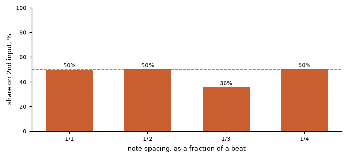
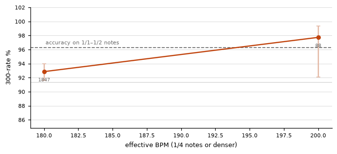
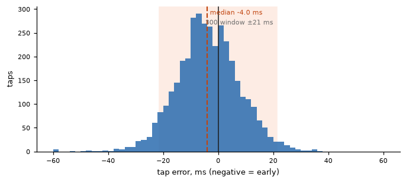
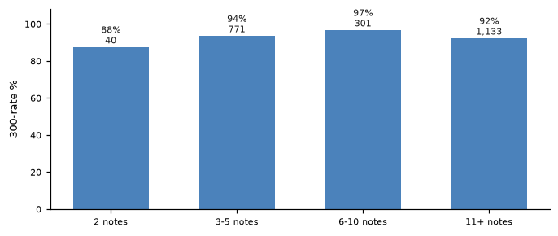

# osu! replay report — ExamplePlayer

*3,724 taps over 6 replays · 2026-04-03 to 2026-10-10 · osu!standard · generated 2026-11-02*

## The short version

You share the tapping between two inputs at every speed — both of them are used on slow notes and on streams alike.

*50% of slow notes and 50% of stream notes come from the second input.*

Three words used below. **Streams** are the fast runs of notes — a quarter of a beat apart or denser — the parts that need two inputs. **Spread** is how far a tap usually lands from the note; a bigger number means less consistent. The **window** is the timing the game allows, ±21.3 ms here for a 300.

**Streams are no harder for you than slow notes.** Your taps spread about 11 ms on streams and 11 ms on slow notes — about the same, and they score about the same (93% against 96%).

**Your streams mostly start on the beat.** The first two taps are off by more than 12 ms in 24% of your streams, and off by 24 ms or more in 2% — the rest begin on time.

**Your two inputs are close, but not quite locked.** On a stream they land about 4 ms apart, against about 5 ms of stray in each one on its own. Near enough to moving as a single unit, but not there. None of it is a fixed lag: one input is not consistently ahead of the other, so there is nothing constant to adjust.

**How fast you can go.** Your fastest streams run at about 180 BPM, where 93% of the notes land as 300s, against 96% on slow notes. At every speed you played, accuracy stays within 5 points of your slow-note level.

**You tap a little early.** Your taps land about 4 ms early on average, and centring them would be worth roughly +1.1 accuracy points. That is arithmetic on your own numbers, not a promise.

The sections below give the detail and explain each number. If you read only one, read **Speed**: it answers how fast you can go before accuracy drops, and it is the number that changes most as you improve.

## At a glance

| | |
|:--|:--|
| **Playstyle** | alternates throughout |
| **Maps played** | 6.15★ – 7.19★ &nbsp;·&nbsp; 181–204 BPM |
| **Notes judged** | 3,724 taps over 6 replays |
| **Accuracy** | 94.5% of taps inside the 300 window &nbsp;·&nbsp; reported accuracy 96.4% — the game's own weighted figure, not the same quantity |
| **Timing** | -4.1 ms mean, 11.5 ms scatter |
| **Stream speed** | reaches 170–190 BPM at 92.9% (1,847 taps); holds the 90% bar up to 170–190 BPM |
| **Accuracy drops at** | no drop found — 1/4 accuracy holds the level of the slower notes |
| **Hand-to-hand** | 4.2 ms separation between the two inputs, against 5.0 ms of jitter within each (ratio 0.84) |

## 1. Playstyle

**alternates throughout.** Both inputs are used about equally at every speed (50% and 50%). Taps are shared between the two inputs from 1/1 upwards.

A replay cannot say which device fired a tap — the game folds keyboard keys and mouse buttons into the same two actions — but it does say how many inputs were used and how they are spread across note densities, which is what separates the styles. The share on the second input, by spacing:

| spacing | taps | 300-rate | 2nd input | median eff. BPM |
|:--|--:|--:|--:|--:|
| 1/1 | 666 | 96.7% | 49.7% | 47 |
| 1/2 | 929 | 96.0% | 49.7% | 95 |
| 1/3 | 45 | 88.9% | 35.6% | 136 |
| 1/4 | 1,935 | 93.1% | 49.9% | 190 |

## 2. Speed

Notes are labelled by how much of a beat they are spaced apart, read from the map's own timing points, then converted to an **effective BPM**: the BPM the map would need for the same note rate as 1/4 notes. A 1/8 stream on a 96 BPM map is 192 effective BPM. Notes per second is effective BPM ÷ 15.

**1/4 notes and denser** — the speeds that need two inputs:

| eff. BPM | notes/s | spacing | taps | 300-rate |
|:--|--:|--:|--:|--:|
| 170–190 | 12.0 | 1/4 | 1,847 | 92.9% |
| 190–210 | 13.3 | 1/4 | 88 (thin) | 97.7% |

- **Held to:** **170–190 BPM** at 92.9% on 1,847 taps (bar: 90% 300s, minimum 100 taps).
- **Fastest measured:** 170–190 BPM (12.0 notes/s) at 92.9% on 1,847 taps.
- **Reference level:** 96.3% on 1/1–1/2 notes (1,595 taps). Every judgement below is against this, not against a fixed standard.
- **First drop:** none. 1/4 accuracy stays within 5 points of the 96.3% scored on the slower notes.
- **Precision cost of alternating:** 0.99× — tap scatter on 1/4+ notes (11.3 ms) against 1/1–1/2 notes (11.4 ms). Below 1 means the denser notes are *steadier* than the slow ones.

> **What "precision cost" means.** It is a ratio of your own numbers: how widely your taps scatter on 1/4-and-denser notes, divided by how widely they scatter on 1/2-and-slower notes, measured inside the same replays. **1.00 means density costs you nothing extra**; 1.60 means the dense notes are 60% wider. It is deliberately a within-player figure, so it does not move with how good you are — a strong player and a weak player can both score 1.5 — and it is why this report decides it from scatter rather than from accuracy: once most taps land inside the window, the accuracy figure stops resolving differences that are still there in the spread.

*Numbers under the points are taps in that bucket. The dashed line is the player's own accuracy on the slower notes.*

## 3. Timing

| quantity | value | note |
|:--|--:|:--|
| mean error | -4.1 ms | negative = early |
| median error | -4.0 ms |  |
| scatter (own bias removed) | 11.5 ms | how wide the errors are around the player's own centre |
| taps late | 34.4% |  |
| median 300 window | ±21.3 ms | from each map's own OD and mods |
| centring the errors would be worth | +1.12 points of 300-rate | arithmetic, not a promise |

## 4. The two inputs

| input | taps | share | on 1/1–1/2 | on 1/4+ | bias ms | scatter ms | 300-rate |
|:--|--:|--:|--:|--:|--:|--:|--:|
| input 1 | 1,850 | 49.7% | 50% | 50% | -5.4 | 11.7 | 93.2% |
| input 2 | 1,874 | 50.3% | 50% | 50% | -2.8 | 11.6 | 95.8% |

**Hand-to-hand timing.** Inside strictly alternating stretches, consecutive interval errors split into a part the two inputs share and a part where they disagree. The disagreeing part, with each input's own jitter removed:

| quantity | value | meaning |
|:--|--:|:--|
| hand-to-hand separation | 4.2 ms | how far apart the two inputs land |
| own jitter floor | 5.0 ms | how far one input lands from itself |
| ratio | 0.84 | above 1 means the inputs disagree more than they each wobble |
| consistent offset | ≈0 ms | a fixed lag of one input behind the other, if any |
| random part | 7.4 ms | the part that varies from pair to pair |

*Measured on 1,625 alternating pairs in 310 runs.*

> **What these mean, and why they are separate.** The separation and the jitter floor answer two different questions, and the comparison between them is the point. If your two inputs land no further apart than each one lands from itself, they are moving as a single unit and there is nothing to keep in time. The **consistent offset** answers a further question: whether that disagreement is a fixed lag that a timing adjustment could remove, or something that changes every pair. A large offset with a small random part means one input reliably runs ahead of the other. A small offset with a large random part means the two are not reliably out of step but unreliably *in* step — and no single adjustment fixes that, because there is no fixed amount to adjust by.

## 5. Inside streams

| quantity | value | meaning |
|:--|--:|:--|
| runs found | 310 | 1/4-or-denser sequences, two notes or longer |
| intervals on the grid | 84.7% | press intervals within ±15% of the note spacing |
| intervals badly off | 0.1% | more than 50% out — a note effectively dropped |
| pairs re-pressed | 0.0% | two presses under 25 ms apart |
| strict alternation | 100.0% | consecutive taps never on the same input — style-dependent, so read it against the playstyle above |
| first interval >15% out | 23.9% | how often a run is already off the beat at its first pair |
| first interval >30% out | 1.9% |  |

> **What the first-interval figures mean.** They check whether a stream begins on the beat or is already broken before it gets going. These two patterns look very different here. A player who starts cleanly and then drifts shows a low figure at the first pair with worse numbers deeper into the run. A player whose beat never establishes shows a high figure at the very first pair that does not then get worse. The run-length table below separates them: a deficit at 2 notes is about the alternating pair itself, while a deficit that only appears at 11+ is about holding on.

**Accuracy by how long the unbroken run is** — a deficit at 2 notes means the problem is in the alternating pair itself; a deficit that grows with length means endurance or drift:

| run length | taps | 300-rate |
|:--|--:|--:|
| 2 notes | 40 | 87.5% |
| 3-5 notes | 771 | 93.5% |
| 6-10 notes | 301 | 96.7% |
| 11+ notes | 1,133 | 92.2% |

## 6. Maps analysed

| map | difficulty | ★ | mods | speed | taps | acc | link |
|:--|--:|--:|--:|--:|--:|--:|--:|
| Pythia – Heartless (Cut Ver.) | Indifference | 7.19 | NM | 1.00× | 703 | 93.31% | [5671885](https://osu.ppy.sh/b/5671885) |
| positive MAD-crew – Mynarco | Withdrawals | 6.21 | NM | 1.00× | 680 | 97.11% | [1726994](https://osu.ppy.sh/b/1726994) |
| ke-ji feat. Nanahira – Ange du Blanc Pur | Extra | 6.15 | NM | 1.00× | 1,042 | 97.38% | [2477065](https://osu.ppy.sh/b/2477065) |
| Ayane – GO Love&Peace | Insane | — | DT | 1.50× | 329 | 99.19% | [551348](https://osu.ppy.sh/b/551348) |
| Pythia – Heartless (Cut Ver.) | Zabrid's Expert | — | HR | 1.00× | 676 | 93.49% | [5682373](https://osu.ppy.sh/b/5682373) |
| eyelis – Kizuna ni Nosete (TV EDIT) | SnowWhite | — | DT | 1.50× | 294 | 97.97% | [741840](https://osu.ppy.sh/b/741840) |

Star ratings come from the public mirrors *today*, not from the version played, and a replay does not carry one. Mods marked with a speed above 1.00 were converted back to real-time milliseconds before anything was measured.

## Method

Every tap is paired with the note the game judged it against, and the pairing is checked: the counts the model produces are compared with the 300/100/50/miss counts the replay itself recorded, and a replay whose counts cannot be reproduced is reported rather than quietly used. Hit windows come from each map's own OD and mods. The full definitions, and what replay analysis cannot see, are in `docs/metrics.md` and `docs/limitations.md`.

*Generated by osu-replay-report. See docs/posting-results.md to share this.*
