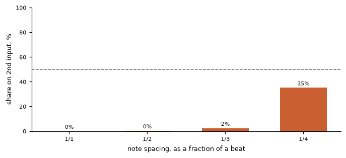
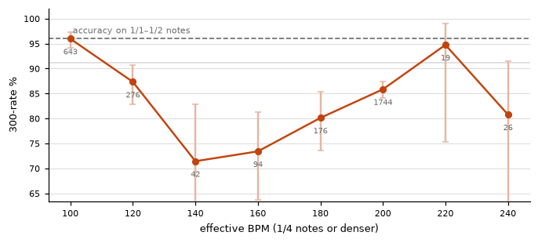
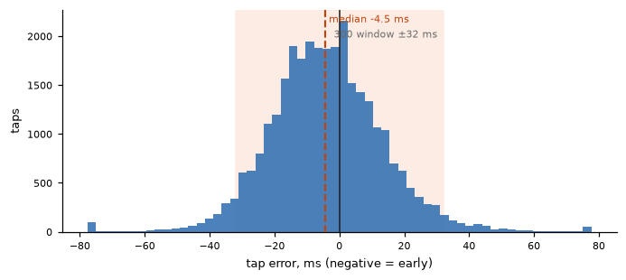
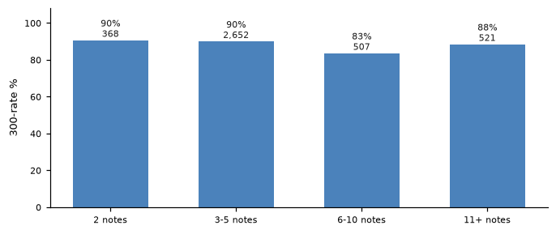

# osu! replay report — ExamplePlayer

*30,572 taps over 50 replays · 2025-09-02 to 2026-10-31 · osu!standard · generated 2026-11-02*

## The short version

You tap with one input for almost everything, and bring in a second one only once the notes get fast. That is what tapping with a pen tip or one finger looks like: the first input carries the slow notes, the second appears when the notes outrun it.

*0% of your slow notes come from the second input; 35% of your stream notes do.*

Three words used below. **Streams** are the fast runs of notes — a quarter of a beat apart or denser — the parts that need two inputs. **Spread** is how far a tap usually lands from the note; a bigger number means less consistent. The **window** is the timing the game allows, ±32.0 ms here for a 300.

*In your streams, 32% of the time two notes in a row come from the same input instead of alternating.*

*Most of that is not a mistimed pair: only 3% of your stream intervals are two presses within 25 ms of each other, which is what a dropped note looks like. The rest are deliberate single taps on the slower streams.*

**Streams are where your accuracy goes.** Your stream taps spread about 25 ms either side of the note; slow notes spread about 16 ms. The fast notes are the ones you are least sure of, and it shows in the score: 87% of stream taps land as 300s against 96% of slow ones. The ratio between those two spreads is 1.6×, which the table below calls the precision cost of alternating.

**Your streams start off the beat, and stay there.** When a stream begins, the first two notes are usually mistimed: in 47% of your streams the gap between those two taps is off by more than 11 ms, and in 25% it is off by 22 ms or more. It does not get worse further into the stream, so you are not losing the beat partway through — it is not there to begin with.

**Your two inputs are not in time with each other.** On a stream they land about 20 ms apart, while each one on its own only strays about 13 ms from where it usually is. So the two are further apart from each other than either is from itself — it is the switching between them that is loose, not the taps themselves. None of it is a fixed lag: one input is not consistently ahead of the other, so there is nothing constant to adjust.

**How fast you can go.** Your fastest streams run at about 200 BPM, where 86% of the notes land as 300s, against 96% on slow notes. The slippage starts from about 120 BPM.

**You tap a little early.** Your taps land about 4 ms early on average, and centring them would be worth roughly +0.7 accuracy points. That is arithmetic on your own numbers, not a promise.

The sections below give the detail and explain each number. If you read only one, read **Speed**: it answers how fast you can go before accuracy drops, and it is the number that changes most as you improve.

## At a glance

| | |
|:--|:--|
| **Playstyle** | alternates on streams only |
| **Maps played** | 5.00★ – 6.86★ &nbsp;·&nbsp; 92–270 BPM |
| **Notes judged** | 30,572 taps over 50 replays |
| **Accuracy** | 95.1% of taps inside the 300 window &nbsp;·&nbsp; reported accuracy 96.9% — the game's own weighted figure, not the same quantity |
| **Timing** | -4.1 ms mean, 17.2 ms scatter |
| **Stream speed** | reaches 190–210 BPM at 85.8% (1,744 taps); holds the 90% bar up to 90–110 BPM |
| **Accuracy drops at** | 110–130 BPM |
| **Hand-to-hand** | 20.5 ms separation between the two inputs, against 13.0 ms of jitter within each (ratio 1.58) |

## 1. Playstyle

**alternates on streams only.** A second input is used for 0% of notes at 1/2 and slower but 35% at 1/4 and denser. One input carries all the slow notes and the other joins only when the notes outrun it. This is the pattern of a player tapping with a pen tip or one finger and reaching for a second key for streams.

A replay cannot say which device fired a tap — the game folds keyboard keys and mouse buttons into the same two actions — but it does say how many inputs were used and how they are spread across note densities, which is what separates the styles. The share on the second input, by spacing:

| spacing | taps | 300-rate | 2nd input | median eff. BPM |
|:--|--:|--:|--:|--:|
| 1/1 | 7,500 | 97.2% | 0.0% | 50 |
| 1/2 | 16,419 | 95.6% | 0.3% | 100 |
| 1/3 | 205 | 97.6% | 2.4% | 104 |
| 1/4 | 2,995 | 87.2% | 35.1% | 200 |
| 1/8 | 26 | 84.6% | 46.2% | 200 |

## 2. Speed

Notes are labelled by how much of a beat they are spaced apart, read from the map's own timing points, then converted to an **effective BPM**: the BPM the map would need for the same note rate as 1/4 notes. A 1/8 stream on a 96 BPM map is 192 effective BPM. Notes per second is effective BPM ÷ 15.

**1/4 notes and denser** — the speeds that need two inputs:

| eff. BPM | notes/s | spacing | taps | 300-rate |
|:--|--:|--:|--:|--:|
| 90–110 | 6.7 | 1/4 | 643 | 96.0% |
| 110–130 | 8.0 | 1/4 | 276 | 87.3% |
| 130–150 | 9.3 | 1/4 | 42 (thin) | 71.4% |
| 150–170 | 10.7 | 1/4 | 94 (thin) | 73.4% |
| 170–190 | 12.0 | 1/4 | 176 | 80.1% |
| 190–210 | 13.3 | 1/4, 1/8 | 1,744 | 85.8% |
| 210–230 | 14.7 | 1/4 | 19 (thin) | 94.7% |
| 230–250 | 16.0 | 1/4 | 26 (thin) | 80.8% |

- **Held to:** **90–110 BPM** at 96.0% on 643 taps (bar: 90% 300s, minimum 100 taps).
- **Fastest measured:** 190–210 BPM (13.3 notes/s) at 85.8% on 1,744 taps.
- **Reference level:** 96.1% on 1/1–1/2 notes (23,919 taps). Every judgement below is against this, not against a fixed standard.
- **First drop:** 110–130 BPM at 87.3%, which is more than 5 points below the 96.1% scored on 1/1–1/2 notes.
- **Precision cost of alternating:** 1.61× — tap scatter on 1/4+ notes (25.4 ms) against 1/1–1/2 notes (15.8 ms). Below 1 means the denser notes are *steadier* than the slow ones.

> **What "precision cost" means.** It is a ratio of your own numbers: how widely your taps scatter on 1/4-and-denser notes, divided by how widely they scatter on 1/2-and-slower notes, measured inside the same replays. **1.00 means density costs you nothing extra**; 1.60 means the dense notes are 60% wider. It is deliberately a within-player figure, so it does not move with how good you are — a strong player and a weak player can both score 1.5 — and it is why this report decides it from scatter rather than from accuracy: once most taps land inside the window, the accuracy figure stops resolving differences that are still there in the spread.

*Numbers under the points are taps in that bucket. The dashed line is the player's own accuracy on the slower notes.*

## 3. Timing

| quantity | value | note |
|:--|--:|:--|
| mean error | -4.1 ms | negative = early |
| median error | -4.5 ms |  |
| scatter (own bias removed) | 17.2 ms | how wide the errors are around the player's own centre |
| taps late | 38.0% |  |
| median 300 window | ±32.0 ms | from each map's own OD and mods |
| centring the errors would be worth | +0.70 points of 300-rate | arithmetic, not a promise |

## 4. The two inputs

| input | taps | share | on 1/1–1/2 | on 1/4+ | bias ms | scatter ms | 300-rate |
|:--|--:|--:|--:|--:|--:|--:|--:|
| input 1 | 29,448 | 96.3% | 100% | 65% | -4.0 | 17.1 | 95.6% |
| input 2 | 1,124 | 3.7% | 0% | 35% | -6.9 | 34.2 | 79.7% |

**Hand-to-hand timing.** Inside strictly alternating stretches, consecutive interval errors split into a part the two inputs share and a part where they disagree. The disagreeing part, with each input's own jitter removed:

| quantity | value | meaning |
|:--|--:|:--|
| hand-to-hand separation | 20.5 ms | how far apart the two inputs land |
| own jitter floor | 13.0 ms | how far one input lands from itself |
| ratio | 1.58 | above 1 means the inputs disagree more than they each wobble |
| consistent offset | -0.3 ms | a fixed lag of one input behind the other, if any |
| random part | 25.9 ms | the part that varies from pair to pair |

*Measured on 1,346 alternating pairs in 1,033 runs.*

> **What these mean, and why they are separate.** The separation and the jitter floor answer two different questions, and the comparison between them is the point. If your two inputs land no further apart than each one lands from itself, they are moving as a single unit and there is nothing to keep in time. The **consistent offset** answers a further question: whether that disagreement is a fixed lag that a timing adjustment could remove, or something that changes every pair. A large offset with a small random part means one input reliably runs ahead of the other. A small offset with a large random part means the two are not reliably out of step but unreliably *in* step — and no single adjustment fixes that, because there is no fixed amount to adjust by.

## 5. Inside streams

| quantity | value | meaning |
|:--|--:|:--|
| runs found | 1,033 | 1/4-or-denser sequences, two notes or longer |
| intervals on the grid | 49.4% | press intervals within ±15% of the note spacing |
| intervals badly off | 12.6% | more than 50% out — a note effectively dropped |
| pairs re-pressed | 2.9% | two presses under 25 ms apart |
| strict alternation | 68.0% | consecutive taps never on the same input — style-dependent, so read it against the playstyle above |
| first interval >15% out | 47.3% | how often a run is already off the beat at its first pair |
| first interval >30% out | 25.4% |  |

> **What the first-interval figures mean.** They check whether a stream begins on the beat or is already broken before it gets going. These two patterns look very different here. A player who starts cleanly and then drifts shows a low figure at the first pair with worse numbers deeper into the run. A player whose beat never establishes shows a high figure at the very first pair that does not then get worse. The run-length table below separates them: a deficit at 2 notes is about the alternating pair itself, while a deficit that only appears at 11+ is about holding on.

**Accuracy by how long the unbroken run is** — a deficit at 2 notes means the problem is in the alternating pair itself; a deficit that grows with length means endurance or drift:

| run length | taps | 300-rate |
|:--|--:|--:|
| 2 notes | 368 | 90.5% |
| 3-5 notes | 2,652 | 89.9% |
| 6-10 notes | 507 | 83.4% |
| 11+ notes | 521 | 88.3% |

## 6. Maps analysed

| map | difficulty | ★ | mods | speed | taps | acc | link |
|:--|--:|--:|--:|--:|--:|--:|--:|
| Yamajet feat. haru*ama*nya – Sweets Holic (Cut Ver.) | Kumocha's Extreme | 6.86 | NF | 1.00× | 439 | 98.42% | [5049011](https://osu.ppy.sh/b/5049011) |
| Alvaro Soler – El Mismo Sol (Cut Ver.) | Sunshine | 6.76 | NF | 1.00× | 278 | 96.19% | [4913905](https://osu.ppy.sh/b/4913905) |
| tokken – tokken | tokken | 6.63 | NM | 1.00× | 416 | 96.19% | [1784600](https://osu.ppy.sh/b/1784600) |
| Fireflight – Unbreakable (Nightcore Mix) | Unbreakable (AR10) | 6.55 | NM | 1.00× | 661 | 96.32% | [758578](https://osu.ppy.sh/b/758578) |
| ONE OK ROCK – American Girls (Juztan Remix) | Extreme | 6.51 | NF | 1.00× | 223 | 96.86% | [5075617](https://osu.ppy.sh/b/5075617) |
| Remo Prototype[CV: Hanamori Yumiri] – Sendan Life | Extra | 6.27 | NF | 1.00× | 833 | 97.32% | [972691](https://osu.ppy.sh/b/972691) |
| Alvaro Soler – El Mismo Sol (Cut Ver.) | Parad0xa's Extra | 6.26 | NM | 1.00× | 266 | 96.25% | [4913996](https://osu.ppy.sh/b/4913996) |
| utsuP – The Dying Message | Wan | 6.19 | NM | 1.00× | 1,238 | 96.57% | [247313](https://osu.ppy.sh/b/247313) |
| DJ Okawari – Flower Dance (Short Ver.) | Dance AR10 | 6.07 | NM | 1.00× | 811 | 98.00% | [580937](https://osu.ppy.sh/b/580937) |
| DJ Okawari – Flower Dance (Short Ver.) | Dance AR10 | 6.07 | NF | 1.00× | 811 | 97.24% | [580937](https://osu.ppy.sh/b/580937) |
| DJ Okawari – Flower Dance (Short Ver.) | Dance AR10 | 6.07 | NM | 1.00× | 812 | 97.77% | [580937](https://osu.ppy.sh/b/580937) |
| DJ Okawari – Flower Dance (Short Ver.) | Dance AR10 | 6.07 | NM | 1.00× | 810 | 96.53% | [580937](https://osu.ppy.sh/b/580937) |
| DJ Okawari – Flower Dance (Short Ver.) | Dance AR10 | 6.07 | NM | 1.00× | 812 | 97.63% | [580937](https://osu.ppy.sh/b/580937) |
| DJ Okawari – Flower Dance (Short Ver.) | Dance AR10 | 6.07 | NM | 1.00× | 812 | 98.33% | [580937](https://osu.ppy.sh/b/580937) |
| DJ Okawari – Flower Dance (Short Ver.) | Dance AR10 | 6.07 | NM | 1.00× | 812 | 97.88% | [580937](https://osu.ppy.sh/b/580937) |
| Reol – Heimenkyou | Shattered World | 5.97 | NM | 1.00× | 697 | 96.61% | [1812660](https://osu.ppy.sh/b/1812660) |
| GARNiDELiA – Yakusoku -Promise code- | Extra | 5.97 | NM | 1.00× | 867 | 96.43% | [1536487](https://osu.ppy.sh/b/1536487) |
| FujuniseikouyuuP – FREEDMAN | Nouk | 5.97 | NM | 1.00× | 581 | 96.92% | [283965](https://osu.ppy.sh/b/283965) |
| Various Artists – Square Jump Practice Maps | Rockefeller Street BPM162.5 Holy Shit!!This is Square Jump!!AR10 | 5.87 | NM | 1.00× | 724 | 96.56% | [305259](https://osu.ppy.sh/b/305259) |
| UNDEAD CORPORATION – Yoru Naku Usagi wa Yume o Miru | Lunatic | 5.72 | NM | 1.00× | 958 | 96.14% | [176960](https://osu.ppy.sh/b/176960) |
| UNDEAD CORPORATION – Yoru Naku Usagi wa Yume o Miru | Lunatic | 5.72 | NM | 1.00× | 956 | 96.09% | [176960](https://osu.ppy.sh/b/176960) |
| Caravan Palace – Miracle | Extra | 5.68 | NM | 1.00× | 663 | 96.34% | [1980432](https://osu.ppy.sh/b/1980432) |
| Caravan Palace – Miracle | Extra | 5.68 | NM | 1.00× | 663 | 96.39% | [1980432](https://osu.ppy.sh/b/1980432) |
| Caravan Palace – Miracle | Extra | 5.68 | NM | 1.00× | 662 | 97.09% | [1980432](https://osu.ppy.sh/b/1980432) |
| Caravan Palace – Miracle | Extra | 5.68 | NM | 1.00× | 663 | 96.29% | [1980432](https://osu.ppy.sh/b/1980432) |
| Caravan Palace – Miracle | Extra | 5.68 | NM | 1.00× | 663 | 97.34% | [1980432](https://osu.ppy.sh/b/1980432) |
| Caravan Palace – Miracle | Extra | 5.68 | NM | 1.00× | 663 | 97.36% | [1980432](https://osu.ppy.sh/b/1980432) |
| Caravan Palace – Miracle | Extra | 5.68 | NM | 1.00× | 662 | 97.29% | [1980432](https://osu.ppy.sh/b/1980432) |
| Caravan Palace – Miracle | Extra | 5.68 | NM | 1.00× | 663 | 96.74% | [1980432](https://osu.ppy.sh/b/1980432) |
| Caravan Palace – Miracle | Extra | 5.68 | NM | 1.00× | 663 | 97.09% | [1980432](https://osu.ppy.sh/b/1980432) |
| Caravan Palace – Miracle | Extra | 5.68 | NM | 1.00× | 662 | 96.69% | [1980432](https://osu.ppy.sh/b/1980432) |
| Caravan Palace – Miracle | Extra | 5.68 | NM | 1.00× | 663 | 96.54% | [1980432](https://osu.ppy.sh/b/1980432) |
| Dabbackwood – Freak | ??? | 5.65 | NM | 1.00× | 343 | 96.45% | [4730397](https://osu.ppy.sh/b/4730397) |
| Dropgun & Jesse Wilde – Uluwatu | Lost Ship | 5.65 | NM | 1.00× | 463 | 97.29% | [1886935](https://osu.ppy.sh/b/1886935) |
| Rohi – Kakuzetsu Thanatos | RLC | 5.54 | NM | 1.00× | 731 | 96.96% | [216133](https://osu.ppy.sh/b/216133) |
| DJ Fresh – Gold Dust | Insane | 5.41 | NM | 1.00× | 651 | 96.93% | — |
| DJ Fresh – Gold Dust | Insane | 5.41 | NM | 1.00× | 653 | 96.42% | — |
| DJ Fresh – Gold Dust | Insane | 5.41 | NM | 1.00× | 653 | 96.52% | — |
| joyful – chess (slowed down & cut ver.) | kuroame's rato milton | 5.41 | NM | 1.00× | 170 | 96.88% | [4989720](https://osu.ppy.sh/b/4989720) |
| joyful – chess (slowed down & cut ver.) | kuroame's rato milton | 5.41 | NM | 1.00× | 170 | 97.17% | [4989720](https://osu.ppy.sh/b/4989720) |
| IOSYS – The Lovely, Freezing, Tomboyish Bath, Cirno's Hot Spring | Hot Spring | 5.40 | NF | 1.00× | 396 | 96.23% | — |
| Marina and the Diamonds – How to Be a Heartbreaker (Nightcore & Cut Ver.) | Extra | 5.29 | NM | 1.00× | 220 | 99.09% | [5524479](https://osu.ppy.sh/b/5524479) |
| LiSA – Thrill, Risk, Heartless | Akitoshi's Insane | 5.27 | NM | 1.00× | 1,005 | 96.96% | [3197543](https://osu.ppy.sh/b/3197543) |
| shadowraze feat. perfect player – shadowfiend [prod.PLVSTIC BOI] | zxc | 5.26 | NM | 1.00× | 489 | 98.23% | [2978408](https://osu.ppy.sh/b/2978408) |
| Nashimoto Ui – AaAaAaAAaAaAAa | Reform's ExPeRT | 5.16 | NM | 1.00× | 383 | 96.39% | [2129145](https://osu.ppy.sh/b/2129145) |
| LONOWN, riserayss – starly (slowed down & cut ver.) | expert | 5.08 | NM | 1.00× | 244 | 96.58% | [5246696](https://osu.ppy.sh/b/5246696) |
| Gojou Kai – Ultimate Truth | Lunatic | 5.01 | NM | 1.00× | 446 | 96.20% | [159874](https://osu.ppy.sh/b/159874) |
| Komiya Mao – (can you) understand me? | uhh? | 5.01 | NM | 1.00× | 305 | 96.72% | [979155](https://osu.ppy.sh/b/979155) |
| TAK – LEMON MELON COOKIE | Lemon Pop | 5.00 | NM | 1.00× | 571 | 97.15% | [4942376](https://osu.ppy.sh/b/4942376) |
| TAK – LEMON MELON COOKIE | Lemon Pop | 5.00 | NM | 1.00× | 572 | 97.44% | [4942376](https://osu.ppy.sh/b/4942376) |

Star ratings come from the public mirrors *today*, not from the version played, and a replay does not carry one. Mods marked with a speed above 1.00 were converted back to real-time milliseconds before anything was measured.

## Method

Every tap is paired with the note the game judged it against, and the pairing is checked: the counts the model produces are compared with the 300/100/50/miss counts the replay itself recorded, and a replay whose counts cannot be reproduced is reported rather than quietly used. Hit windows come from each map's own OD and mods. The full definitions, and what replay analysis cannot see, are in `docs/metrics.md` and `docs/limitations.md`.

*Generated by osu-replay-report. See docs/posting-results.md to share this.*
